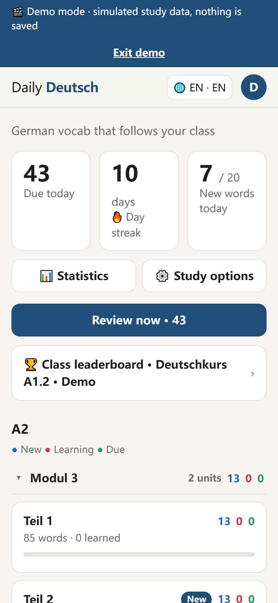
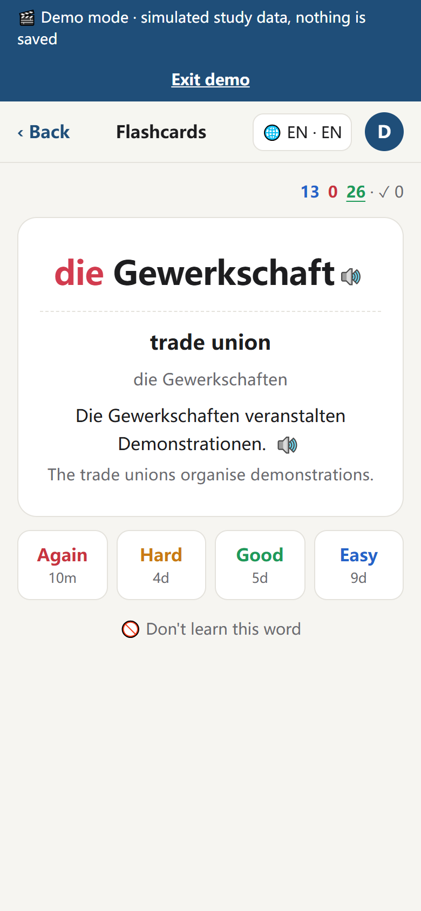
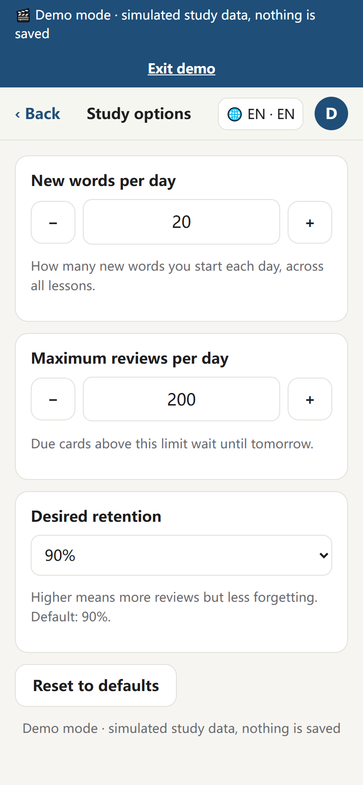
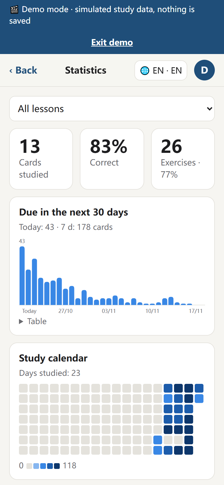
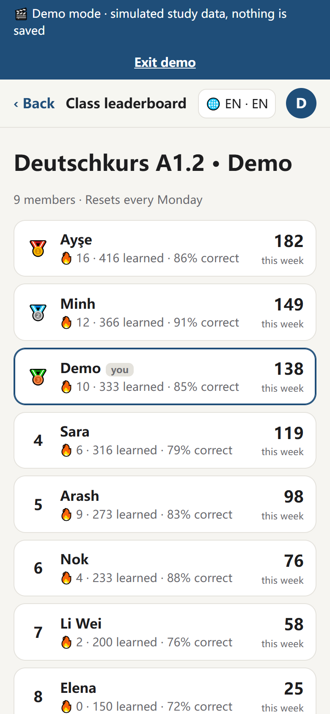

# Daily Deutsch

**A German vocabulary app that follows a real language class.** Each day's lesson becomes flashcards with spaced repetition, drills and a class leaderboard. Classmates from different countries can read the explanations in their own language.

**▶ [Try the live demo](https://yangzhou8833.github.io/daily-deutsch/#/demo)** — no sign-up needed. It opens a simulated learner with three weeks of history in a virtual class; "Exit demo" puts everything back.
App: [yangzhou8833.github.io/daily-deutsch](https://yangzhou8833.github.io/daily-deutsch/)

<p>
  
  
  
  
  
</p>

## Why I built it

I'm learning German in a class where everyone speaks a different first language. Every day I turned the lesson into Anki decks for myself, but most of my classmates don't use Anki, and the explanations were only in Chinese. Daily Deutsch turns those decks into one link the whole class can use on their phones: the same words as the lesson, explained in Chinese, English, Turkish, Thai, Vietnamese or Persian.

## Features

- **Spaced repetition with FSRS, and you can tune it.** Cards are scheduled with [FSRS](https://github.com/open-spaced-repetition/ts-fsrs), the algorithm modern Anki uses. Like Anki's deck options, each learner sets their own **new words per day**, **maximum reviews per day** and **desired retention** (80–95%). The options sync to their account, and "learn 10 more today" works like Anki's custom study.
- **Anki-style progress.** Every lesson shows its *new / learning / due* counts. The statistics page has today's numbers, a 30-day review forecast, a study calendar, card states (new, learning, young, mature) and retention.
- **Drills beyond flashcards:** der/die/das, plurals, typed fill-in sentences (including separable verbs with one box per gap), grammar cloze cards, and Chinese → German sentences.
- **Six explanation languages**, right-to-left Persian included. About 2,500 words have meanings in all six languages, and example sentences are translated into Chinese and English.
- **Classes and a weekly leaderboard.** Learners join with an invite link and compete on weekly answers, streaks and accuracy.
- **Offline-first sync.** Progress is saved on the device right away and synced in the background. Several devices merge by "newest change wins", and the server only ever sees each user's own rows (Row Level Security).
- **AI lesson editor.** An editor uploads a photo of a textbook page or pastes the text, and Claude drafts the vocabulary, examples and grammar cards for review before publishing. Claude is only called from a server-side function.
- **Hide words** you already know, pronunciation through the phone's speech engine (with a clear hint when a browser can't speak), dark mode, phone-first layout.

## How it works

```
Anki decks (.apkg)  ──►  scripts/build_data.py  ──►  static JSON  ──►  React app (GitHub Pages)
  daily lessons         parse, fix, merge,           one file per            │  progress in localStorage
                        add translations             lesson                  ▼
                                                                    Supabase: auth, classes,
                                                                    progress sync, leaderboard,
                                                                    AI lesson editor (Edge Function → Claude)
```

- **Frontend:** React 19 + TypeScript + Vite, hash routing so one static link works on GitHub Pages; deployed by GitHub Actions on every push.
- **Learning engine:** `ts-fsrs` for scheduling; the daily queues (learning, reviews capped by the daily limit, new words capped by the new-word limit) are modelled on Anki.
- **Backend:** Supabase (Postgres, Auth, Row Level Security, SQL functions for joining classes and the leaderboard, an Edge Function for AI generation).
- **Content pipeline:** Python reads the Anki collections, parses old note formats (plurals in umlaut notation, feminine forms, articles), builds cloze sentences, and merges translation and correction overlays keyed by Anki note id, so fixes survive re-imports.

## Problems I solved along the way

- **Messy source data.** The older decks were parsed automatically and had silent errors: wrong plurals, phrases read as nouns, broken cloze gaps, examples without the headword. I reviewed all 1,500 A1.2 words and fixed them through a corrections overlay (`translations/fixes.json`) instead of editing generated files.
- **Reorganising lessons without losing progress.** When the course structure changed, saved progress still pointed at the old lesson ids. The app now moves each card to the lesson that holds the word and uploads the fix on the next sync.
- **Two devices, one learner.** Merging local and server progress by change time, batching uploads, and handling a database column that didn't exist yet without breaking older clients.
- **Mobile speech.** Phone browsers load voices late, drop an utterance after `cancel()`, or (inside apps like WeChat) have no speech engine at all. The app works around the first two and tells the learner what to do in the third case.

## Run locally

```bash
npm install
npm run dev
```

Without Supabase settings the app runs fully offline and hides login.

## Maintaining the content

### Publishing a new lesson

1. Export the day's deck from Anki as `德语_<lesson>.apkg` into the folder above this repo (note types `德语词汇 v2` / `德语语法填空 v2`)
2. Add translations to `translations/<lesson>.json` (`scripts/add_translations.py` imports a batch file) and corrections to `translations/fixes.json`
3. Regenerate the site data:

   ```bash
   npm run data
   ```

4. Commit and push; the site updates automatically and classmates keep using the same link

### Login, classes, leaderboard (Supabase)

1. Create a project at [supabase.com](https://supabase.com) (region: Frankfurt)
2. **SQL Editor** → paste and run [`supabase/schema.sql`](supabase/schema.sql) (safe to run more than once)
3. **Authentication → Sign In / Providers → Email**: turn off **Confirm email** (the free email service only sends a few emails per hour)
4. Put the project URL and the **publishable** key in `.env.production`:

   ```
   VITE_SUPABASE_URL=https://xxxx.supabase.co
   VITE_SUPABASE_KEY=sb_publishable_...
   ```

   The publishable key is designed to be public; data is protected by Row Level Security in `schema.sql`. **Never** put the secret / service_role key in the frontend.

### Structure

```
scripts/ankiread.py        reads notes from .apkg; turns Chinese grammar labels into German terms
scripts/build_data.py      apkg + translations + fixes → public/data/*.json
scripts/courses.py         which deck feeds which lesson (A2 Modul / Teil, A1.2 one lesson per Modul)
translations/              per-lesson translations and fixes.json (keyed by Anki note id)
public/data/               site data (generated)
src/store.ts               FSRS scheduling, daily queues, learning log (localStorage)
src/settings.ts            study options (daily limits, desired retention)
src/stats.ts               numbers for the statistics page
src/sync.ts                offline-first sync of progress to Supabase
src/account.ts             login, profile, class, leaderboard
src/demo.ts                demo mode (#/demo)
src/drills/                article / plural / fill-in / grammar / sentence drills
supabase/schema.sql        tables, RLS policies, class and leaderboard functions
supabase/functions/        Edge Function that asks Claude to draft lesson cards
```

Product decisions: [PRODUCT.md](PRODUCT.md).
